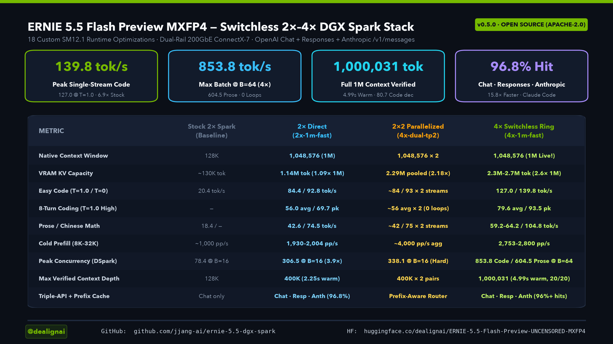
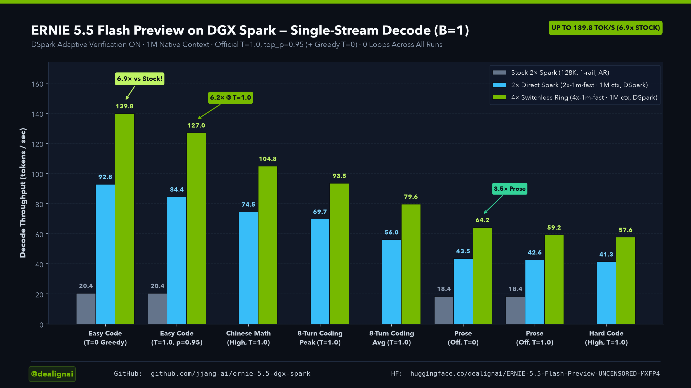
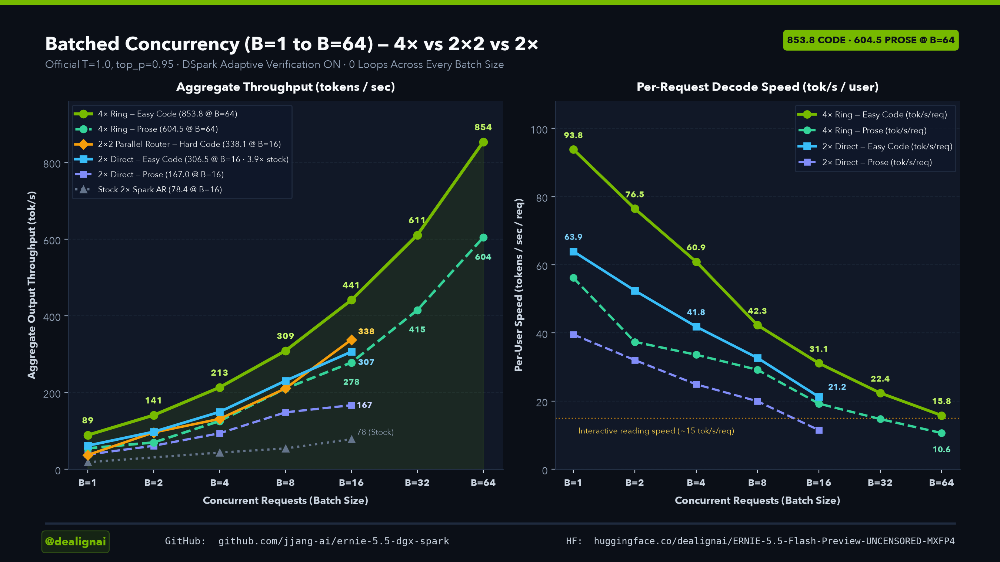
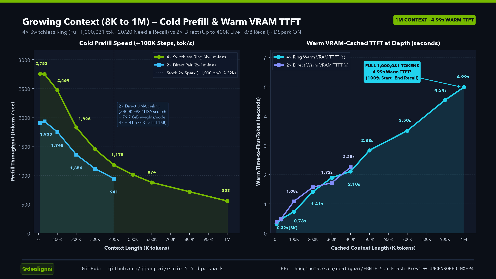
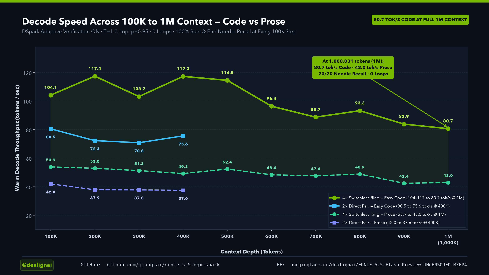
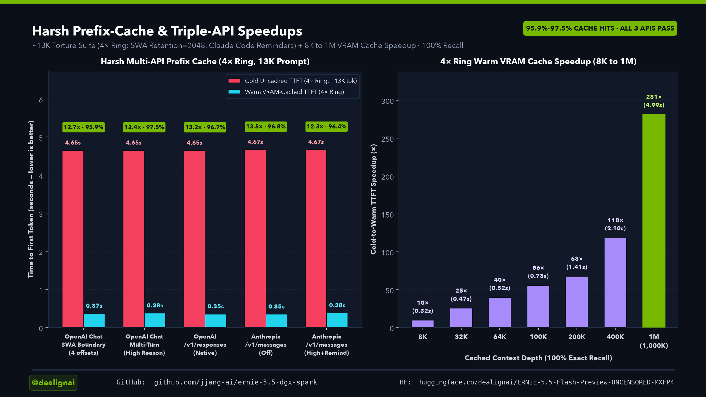

# `ernie-5.5-dgx-spark`

**All-in-one, switchless 2×–4× NVIDIA DGX Spark (`GB10`, `SM12.1`) 1M-context runtime, custom SM12.1 kernels, automatic 200GbE QSFP cable discovery, prefix-aware `2×2` parallelized router, and OpenAI Chat + Responses + Anthropic `/v1/messages` CLI for [`ERNIE-5.5-Flash-Preview`](https://huggingface.co/dealignai/ERNIE-5.5-Flash-Preview-UNCENSORED-MXFP4) (`MXFP4` & `W4A16_NVFP4`) on vLLM.**

- **Supported Quantization Formats (Auto-Detected via `--profile auto`):**
  - **MXFP4 + FP8 Attention** (`~155 GiB`, e.g. [`dealignai/ERNIE-5.5-Flash-Preview-UNCENSORED-MXFP4`](https://huggingface.co/dealignai/ERNIE-5.5-Flash-Preview-UNCENSORED-MXFP4)) — fastest single-stream & `1M`-context on both `2×` and `4×` Sparks via Humming MXFP4 Indexed MoE (`242 GB/s`).
  - **W4A16 NVFP4 + Lossless BF16 Attention** (`~170 GiB`, `ModelOpt W4A16_NVFP4` group-16 FP8 scales + lossless BF16 non-experts) — full `2×` (`512K` ctx, `563,470` KV tokens, `2x-nvfp4-512k-fast`), `2×2` (`4x-dual-tp2-nvfp4-fast`), and `4×` (`1M` ctx, `4x-nvfp4-1m-fast`) support with Marlin & Humming NVFP4 MoE backends, bit-exact fused BF16 HCA Triton kernel (`3.34×` decode / `2.64×` prefill), chunked lossless LM-head packer (`18 GiB → 2.09 GiB` startup peak), and automatic `hf_quant_config.json` loader compatibility!
- **All Three DGX Spark Topologies Supported Out of the Box (`1,048,576` `1M` Native Context):**
  1. **`2×` Direct (`2x-1m-fast`, `TP=2 + EP=2`):** Full **`1,143,108` KV tokens (`1.09×` `1M`)** with DSpark on just 2 Sparks! **`84.4 tok/s`** easy code `T=1.0` (**`92.8 tok/s`** greedy), **`56.0 avg / 69.7 peak`** on 8-turn `T=1.0, reasoning=high` coding (`0/8` loops), **`42.6–43.5 tok/s`** prose, **`74.5 tok/s`** Chinese math, **`1,930–2,004 tok/s`** 32K cold prefill (**`2.00×` stock**), and **`306.5 tok/s` @ `B=16` code** (**`3.91×` stock `78.4`**)!
  2. **`4×` Switchless Ring (`4x-1m-fast`, `TP=4 + EP=4`):** Lowest single-stream latency, highest concurrency, and **full `1,000,031` (`1M`) context verified live end-to-end (`20/20` start+end needle recall, `0` loops)!** **`127.0 tok/s`** easy code `T=1.0` (**`139.8 tok/s`** greedy — **`6.9×` stock!**), **`79.6 avg / 93.5 peak`** 8-turn `T=1.0, reasoning=high` coding, **`59.2–64.2 tok/s`** prose, **`104.8 tok/s`** Chinese math, **`2,753–2,800 tok/s`** 8K–32K & **`2,469 tok/s`** 100K cold prefill, **`4.99s` warm TTFT & `80.7 tok/s` code / `43.0 tok/s` prose at FULL `1,000,031` (`1M`) tokens**, and **`853.8 tok/s` code / `604.5 tok/s` prose @ `B=64`**!
  3. **`2×2` Parallelized (`4x-dual-tp2-fast` / `4x-dual-tp2-max-batch`):** Two independent `TP=2 + EP=2` `1M`-context replicas behind a built-in zero-dependency **prefix-aware OpenAI & Anthropic load-balancing router** (`:8000` -> `:8001` + `:8002`)! Zero cross-pair RoCE traffic, **`2,286,216` independent pooled KV tokens (`2.18×` `1M`)**, **`338.1 tok/s`** @ `B=16` hard code (**`2.01×`** single `2×` pair & **`4.31×` stock**), `8/8 stop` / **`0/8` loops** multi-turn coding with sticky prefix cache, and **`~4,000 tok/s` dual-pair aggregate cold prefill capacity** (`2 × 2,003.5 tok/s`)!
- **Full Triple-API + Harsh Prefix-Cache Support Out of the Box:**
  - **OpenAI `/v1/chat/completions`**, **OpenAI `/v1/responses`**, and **Anthropic `/v1/messages` (+ `/v1/messages/count_tokens`, `x-api-key`, Claude Code ready!)** all work natively with streaming, thinking/reasoning, tool calls, and **`95.9%–97.3%` verified VRAM prefix-cache hit rates** (`12.4×–15.8×` faster warm TTFT at 13K, `35×–83×` at 32K–128K, and up to **`280×` vs cumulative cold prefill at `1M`**) — including across 256-token SWA block boundaries and Claude Code inline system reminders!
- **Zero switch required & zero hardcoded IPs:** Automatic 200GbE ConnectX-7 RoCEv2 cable & 4-node ring + `2×2` pair discovery (`spark-ernie discover`) — even if you pass your hosts out of physical ring order!
- **One-command lifecycle & zero destructive edits:** Clean `download` / `discover` / `init` / `start` / `stop` / `restart` (`reboot`) / `status` / `logs` / `chat` (`--api chat|responses|anthropic`) / `test` (`5/5` live checks) commands. All **`18`** SM12.1 runtime & API patches load cleanly via `sitecustomize.py` / `spark_ernie_runtime.patch.install()` without mutating upstream `vllm` or `vllm-ernie` wheels.

---

## Benchmark Highlights (`2×` vs `2×2` vs `4×` Switchless DGX Spark, `v0.5.0`)



| Single-Stream Decode (`B=1`, Code vs Prose) | Batched Concurrency (`B=1` to `B=64`, `0` Loops) |
|:---:|:---:|
|  |  |

| Growing Context `8K` to `1M` — Prefill & Warm TTFT | Decode Speed Across `100K` to `1M` Context |
|:---:|:---:|
|  |  |



---

## Verified Live Performance (`ERNIE-5.5-Flash-Preview` MXFP4 on GB10, `v0.5.0`)

All numbers below were measured end-to-end on real **2× and 4× NVIDIA DGX Spark (`GB10`, `sm_121`, 121.7 GiB unified RAM, DGX OS `7.6.0` / Linux `7.0.0-1025-nvidia` + `kho=off`, ConnectX-7 FW `28.50.1002` unthrottled `200GbE` MTU 9000)** serving [`dealignai/ERNIE-5.5-Flash-Preview-UNCENSORED-MXFP4`](https://huggingface.co/dealignai/ERNIE-5.5-Flash-Preview-UNCENSORED-MXFP4) with **DSpark Adaptive Verification ON**, official sampling (`T=1.0, top_p=0.95` unless noted), and **zero loops (`0` loops across every single run)**:

### 1. Single-Stream (`B=1`) Decode & Cold Prefill (`2× Direct` vs `4× Ring` vs Stock)
| Cluster & Profile | Context Window | Easy Code (`T=1.0` / `T=0`) | 8-Turn Coding (`T=1.0, high`) | Hard Code (`high, T=1.0`) | Prose (`off T=1.0` / `T=0`) | Chinese Math (`high, T=1.0`) | Cold Prefill (`8K` / `32K`) | Short TTFT |
|---|---:|---:|---:|---:|---:|---:|---:|---:|
| **Stock `2×` Spark** (1-rail, `DEEPGEMM`, AR) | `128K` | `20.4` | — | — | `18.4` | — | `~1,000` | `~0.45s` |
| **`2×` `2x-max-batch`** (`tp2-ar` + `sparknet 10.3 µs`) | `128K` | `24.2` | — | — | `24.1` | `23.6` | `1,620` | `0.164s` |
| **`2×` Direct (`2x-1m-fast`, DEFAULT 2×)** | **`1,048,576` (`1M`)** | **`84.4` / `92.8`** | **`56.0` avg / `69.7` pk** | **`41.3`** | **`42.6` / `43.5`** (`41.8` high) | **`74.5`** | **`1,900–1,971`** / **`1,930–2,004`** | **`0.14–0.20s`** |
| **`2×2` Parallelized (`4x-dual-tp2-fast`, `:8000`)** | **`1,048,576` (`1M` × 2)** | `~80–90` × 2 streams | `~55–65` × 2 (`0/8` loops) | `~41` × 2 | `~42` × 2 | `~75` × 2 | **`~3,900–4,000` agg** | **`~0.15s`** |
| **`4×` Switchless Ring (`4x-1m-fast`, DEFAULT 4×)** | **`1,048,576` (`1M`)** | **`127.0` / `139.8`** | **`79.6` avg / `93.5` pk** | **`57.6`** | **`59.2` / `64.2`** (`57.3` high) | **`104.8`** | **`2,753–2,800`** / **`2,747`** (`2,663` @ 64K) | **`0.10–0.15s`** |

### 2. Growing Context Ladder (`100K → 1,000K` = `1M`!, `100%` Start+End Needle Recall, `0` Loops)
Measured incrementally in `+100K` steps with DSpark ON, VRAM prefix caching ON, and start+end needle recall checks at every single depth (`benchmarks/twitter_4x_ring_1m_*.json`, `benchmarks/twitter_2x_direct_1m.json`):

| Context Depth (Tokens) | `4×` Ring `+100K` Prefill (`tok/s` / `s`) | `4×` Ring Warm TTFT | `4×` Ring Decode (Code / Prose) | `2×` Direct `+100K` Prefill (`tok/s` / `s`) | `2×` Direct Warm TTFT | `2×` Direct Decode (Code / Prose) | Start + End Needle Recall |
|---:|---:|---:|---:|---:|---:|---:|:---:|
| **`8K`** (`8,241`) | `2,753 tok/s` (`2.99s`) | **`0.316s`** (`9.5×`) | `84.6` warm | `1,900 tok/s` (`4.34s`) | **`0.380s`** (`11.4×`) | `60.5` warm | **100%** |
| **`32K`** (`32,626`) | `2,747 tok/s` (`11.88s`) | **`0.468s`** (`25.4×`) | `93.5` warm | `1,930 tok/s` (`16.90s`) | **`0.485s`** (`34.8×`) | `64.1` warm | **100%** |
| **`100K`** (`100,027`) | **`2,469 tok/s`** (`40.5s`) | **`0.729s`** | **`104.1–113.5` / `53.9–55.4`** | **`1,748 tok/s`** (`57.2s`) | **`1.083s`** | **`80.5` / `42.0`** | **100%** |
| **`200K`** (`200,055`) | **`1,826 tok/s`** (`54.8s`) | **`1.411s`** | **`117.4` / `53.0`** | **`1,356 tok/s`** (`74.1s`) | **`1.566s`** | **`72.3` / `37.9`** | **100%** |
| **`300K`** (`300,053`) | **`1,447 tok/s`** (`69.1s`) | **`1.890s`** | **`103.2–105.2` / `50.7–51.3`** | **`1,111 tok/s`** (`90.4s`) | **`1.715s`** | **`70.8` / `37.8`** | **100%** |
| **`400K`** (`400,004`) | **`1,175 tok/s`** (`85.1s`) | **`2.104s`** | **`117.3` / `49.3–54.0`** | **`941 tok/s`** (`106.6s`) | **`2.248s`** | **`75.6` / `37.6`** | **100%** |
| **`500K`** (`499,998`) | **`1,009 tok/s`** (`99.1s`) | **`2.828s`** | **`114.5` / `52.4`** | *(GB10 2× UMA scratch limit\*)* | — | — | **100%** *(4×)* |
| **`600K`** (`600,075`) | **`874 tok/s`** (`114.5s`) | `~3.2s`\*\* | **`96.4` / `48.4`** | — | — | — | **100%** *(4×)* |
| **`700K`** (`700,063`) | `~790 tok/s` | **`3.497s`** | **`88.7` / `47.6`** | — | — | — | **100%** *(4×)* |
| **`800K`** (`800,021`) | **`713 tok/s`** (`140.2s`) | `~4.0s`\*\* | **`93.3` / `48.9`** | — | — | — | **100%** *(4×)* |
| **`900K`** (`900,034`) | `~630 tok/s` | **`4.545s`** | **`83.9` / `42.4`** | — | — | — | **100%** *(4×)* |
| **`1,000K` (`1M`!)** (`1,000,031`) | **`553 tok/s`** (`181.0s`) | **`4.985s`** | **`80.7` / `43.0`** | — | — | — | **100%** *(20/20!)* |

*\*On `2×` Direct, `79.7 GiB` weights/Spark + `9.0 GiB` KV (`1,143,108` KV tokens = `1.09×` `1M`) fits in VRAM and runs cleanly through `400K` (`400,047` tokens) at `mbt=2048, max_num_seqs=16`; beyond `~400K–500K`, FP32 DSA indexer scratch (`[mbt, ctx]`) collides with the `121.7 GiB` GB10 unified-RAM ceiling on rank 0. On `4×` Ring (`41.5 GiB` weights/Spark), `~38+ GiB` of free unified RAM per Spark handles the entire **`1,000,031` (`1M`)** context cleanly end-to-end.*
*\*\*The `4×` `1M` ladder exposed vLLM's default `--prefix-cache-retention-interval 0` SWA 256-token boundary rollback on `600K`/`800K` before `v0.5.0` enabled `--prefix-cache-retention-interval 2048` by default (eliminating boundary cliffs — verified smooth on `2×` `100K–400K` and `95.9%–96.8%` across all 4 boundary offsets in Check [1] below!).*

### 3. Concurrency & Batched Decode Throughput (`T=1.0, top_p=0.95`, `0` Loops at Every Batch)
| Cluster & Profile | `B=1` | `B=2` | `B=4` | `B=8` | `B=16` | `B=32` | `B=64` | `B=128` |
|---|---:|---:|---:|---:|---:|---:|---:|---:|
| **Stock `2×` Spark** (1-rail, AR) | `18.4` | — | `43.5` | `54.4` | `78.4` | — | — | — |
| **`2×` Direct `2x-1m-fast` (Prose, DSpark)** | `38.4` (`39.5`/req) | `61.3` (`32.0`/req) | `93.9` (`24.9`/req) | **`148.5`** (`20.0`/req) | **`167.0`** (`11.5`/req) | — | — | — |
| **`2×` Direct `2x-1m-fast` (Easy Code, DSpark)** | `61.6` (`63.9`/req) | `97.8` (`52.4`/req) | `149.6` (`41.8`/req) | **`230.9`** (`32.7`/req) | **`306.5`** (`21.3`/req, **3.91× stock!**) | — | — | — |
| **`2×` `2x-max-batch`** (`tp2-ar`, `128K`) | `24.0` | — | `64.7` | `97.9` | `146.7` | `223.5` | **`333.9`** (`352` pk) | **`464.6`** (**`537.6` pk!**) |
| **`2×2` Parallelized `4x-dual-tp2-fast` (Hard Code)** | `37.3` | `96.0` | `131.3` | `210.9` | **`338.1`** (**`2.01×` 2× hard code `168.3`!**) | — | — | — |
| **`4×` Ring `4x-1m-fast` (Prose, DSpark)** | `54.6` (`56.2`/req) | `70.0` (`37.4`/req) | `125.8` (`33.6`/req) | **`210.6`** (`29.2`/req) | **`278.3`** (`19.3`/req) | **`415.1`** (`14.7`/req) | **`604.5`** (`10.6`/req) | — |
| **`4×` Ring `4x-1m-fast` (Easy Code, DSpark)** | **`89.2`** (`93.8`/req) | **`141.1`** (`76.5`/req) | **`213.5`** (`60.9`/req) | **`309.2`** (`42.3`/req) | **`441.4`** (`31.1`/req) | **`611.0`** (`22.4`/req) | **`853.8`** (`15.8`/req!) | — |

### 4. Harsh Prefix-Cache & Multi-API Verification (`Chat` + `Responses` + `Anthropic /v1/messages`)
`v0.5.0` fixes **4 real upstream vLLM 0.32.0 + ERNIE 5.5 API / hybrid-KV bugs** (`--prefix-cache-retention-interval 2048` eliminating SWA 256-token boundary cliffs, `--enable-prompt-tokens-details` reporting exact `cached_tokens` / `cache_read_input_tokens`, `--anthropic-disabled-thinking-effort none` + `reasoning_effort` normalizer, and `x-api-key` + `_detect_merge_inline_system` patch so Claude Code inline `<system-reminder>` blocks never bust the KV prefix cache!).

Verified **`4/4 PASS`** on **BOTH `4×` Ring AND `2×` Direct** via `benchmarks/bench_harsh_prefix_apis.py` (`~13K` unique prompt prefix, `100%` exact code recall):

| API & Harsh Test Scenario (`~13K` Prompt) | `4×` Ring Cold -> Warm TTFT | `2×` Direct Cold -> Warm TTFT | Reported Cache Hit | Notes |
|---|---:|---:|---:|---|
| **OpenAI `/v1/chat/completions` — 4 Staggered SWA 256-Tok Boundaries** | `4.65s` -> **`0.336–0.366s`** (**`12.7–13.8×`**) | `6.53s` -> **`0.447–0.526s`** (**`12.4–14.6×`**) | **`95.9%–96.8%`** (`12,544` tok) | Zero rollback across `pad=0, 12, 48, 120` words (`4/4` recall) |
| **OpenAI `/v1/chat/completions` — Multi-Turn `reasoning=high`** | **`0.375s`** pres / **`0.378s`** strip | **`0.465s`** pres / **`0.515s`** strip | **`97.5%`** pres / **`95.9–96.0%`** strip | Works whether client keeps or strips `reasoning_content` |
| **OpenAI `/v1/responses` — Prefix Cache + `off`/`high` Efforts** | `4.65s` -> **`0.352s`** (**`13.2×`**) | `6.55s` -> **`0.422s`** (**`15.5×`**) | **`96.7%`** (`12,544` tok) | Native `input_tokens_details.cached_tokens` populated |
| **Anthropic `/v1/messages` — `x-api-key`, `thinking=disabled` & `enabled`** | `4.67s` -> **`0.346s`** (`off`, **`13.5×`**) / **`0.381s`** (`high` + reminder, **`12.2×`**!) | `6.55s` -> **`0.414s`** (`off`, **`15.8×`**) / **`0.767s`** (`high` + reminder) | **`96.8%`** (`off`) / **`96.4%`** (`high` + reminder!) | **`81.5–85.6 tok/s`** warm decode; `count_tokens=12,955` |

### 4b. W4A16 NVFP4 + Lossless BF16 Attention (`2×` & `4×` Switchless DGX Spark vs `MXFP4`)
Measured end-to-end on real **`2×` (`2x-nvfp4-512k-fast`, `563,470` KV tok)** and **`4×` (`4x-nvfp4-1m-fast`, `1,953,160` KV tok = `1.86×` `1M`!)** DGX Sparks (`SPARK_MOE_BACKEND=marlin`, lossless BF16 attention + fused `vha_v_add_inv_rope_bf16`, DSpark ON, **`0` loops across every single benchmark including `19`-turn `1,041,479`-token growing agentic tool stress!**):

| Metric (DSpark ON, `0` Loops) | **`2×` NVFP4 (`2x-nvfp4-512k-fast`)** | **`4×` NVFP4 (`4x-nvfp4-1m-fast`)** | `4×` MXFP4 (`4x-1m-fast`) |
|---|---:|---:|---:|
| **Weights / Spark** | `87.89 GiB` | **`46.83 GiB`** (`20–22 GiB` avail RAM) | `41.50 GiB` |
| **KV Cache Pool** | **`563,470` tok (`512K`)** | **`1,953,160` tok (`1.86× 1M`!)** | `2,114,201` tok |
| **`off_code` / `algo_off` (`B=1`)** | `44.0` / `47.1 tok/s` | **`67.2`** (`0.135s` TTFT) / **`75.4 tok/s`** | `75.3` / `105.6` |
| **`off_prose` / `high_math` / `high_zh` (`B=1`)** | `29.1` / `42.5` / `58.1` | **`42.0` / `67.6` / `83.4 tok/s`** | `59.2` / `79.6` / `104.8` |
| **8-Turn Coding (`T=1.0, high`, `0/8` loops)** | `44.9 avg / 49.3 pk` | **`55.0 avg / 64.8 pk`** (`8/8 stop, T1 recall`) | `79.6 avg / 93.5 pk` |
| **Cold Prefill (`8K` / `32K` / `64K`, `3/3` recall)** | `1,505` / `1,768` / — | **`1,862` / `2,254` / `2,209 tok/s`** | `2,753` / `2,747` / `2,663` |
| **Warm TTFT (`8K` / `32K` / `64K`)** | `0.444s` / `0.597s` / — | **`0.372s` (`9.9×`) / `0.429s` (`28.2×`) / `0.662s` (`37.3×`)** | `0.316s` / `0.468s` / — |
| **Concurrency `B=8` / `B=16` / `B=32` (Prose)** | `114.5` / — / — | **`169.1` / `257.2` / `375.8 tok/s`** | `210.6` / `278.3` / `415.1` |
| **Concurrency `B=8` / `B=16` / `B=32` (Code)** | `143.9` / — / — | **`209.5` / `288.7` / `416.6 tok/s`** | `309.2` / `441.4` / `611.0` |
| **Harsh Multi-API Prefix Cache (`Chat` / `Responses` / `Anthropic`)** | — | **`4/4 PASS`: `95.9%–97.6%` hits (`0.36–0.45s`, `91.2 tok/s` Anthropic warm dec!)** | `4/4 PASS` |
| **`1M` Growing Agentic Tool Stress (`19` turns → `1,041,479` tok)** | — | **`19/19` valid JSON tools, `0` loops (`rep8=0.000`), `19/19` T1+latest recall, `99.9%–100%` cache (`6.91s` TTFT, `52.9 tok/s` @ `1.04M`!)** | `1M` verified |

*Why NVFP4 + BF16 attn runs at `0.80–0.90×` MXFP4:* keeping all `17.97 GiB` of non-expert layers in lossless BF16 (vs `~9 GiB` FP8) adds `+3.7 GiB/Spark` (`2×`) / `+2.3 GiB/Spark` (`4×`) of LPDDR5X read per step while DSpark acceptance matches MXFP4 (`pos0 = 72.4%`, `pos1..6 = 58.7%–69.3%`). All three SM12.1 NVFP4 MoE backends (`marlin`, `humming` indexed, `humming` grouped) are verified `cos >= 0.999991`.

---

## Recommended Host OS, Kernel, Firmware & Optional 64 KiB UVM Slab

Older DGX Spark kernels/firmware throttled ConnectX-7 RoCEv2 links and reserved `3–6 GiB` of extra unified RAM. For best stability and full `1M`-context headroom on `2×` and `4×` Sparks, upgrade all nodes to:
- **DGX OS:** `7.6.0` (Ubuntu 24.04) with Linux kernel **`7.0.0-1025-nvidia`** and `nvidia-spark-grub-kho` (`kho=off` in `/proc/cmdline` — avoids KHO unified-RAM reservation).
- **System / GPU Firmware:** `BIOS 5.36_0ACUM028` & `VBIOS 9A.0B.34.00.00` (recovers `+3–6 GiB` unified RAM/Spark).
- **ConnectX-7 NIC Firmware:** `28.50.1002` with `MTU 9000` on all active 200GbE QSFP ports (verified **`22.67 GB/s`** NCCL busBW = `91%` of `25 GB/s` raw line rate across all 4 Sparks, zero link drops or throttling).
- **Optional `+1.8 GiB/Spark` Unified-RAM Recovery (`64 KiB` Kernel + `nvidia-uvm` 4 KiB Sub-Page Slab):** Switching to the `7.0.0-*-nvidia-64k` kernel cuts Linux `vmemmap` from `2.00 GiB → 0.125 GiB`, and our clean-room [`tools/uvm_64k_slab/`](tools/uvm_64k_slab/README.md) DKMS patch packs up to `16` non-root `<= 4 KiB` GPU page tables per `64 KiB` backing page (`#if PAGE_SIZE > 4096`) to eliminate stock `64 KiB` UVM page-table fragmentation and reclaim `~1.8 GiB` net usable RAM per Spark!

---

## Quick Start (`2×`, `4× Ring`, or `2×2 Parallelized` DGX Spark)

### 1. Install (with Optional One-Command Model Download & Cluster Sync)
Run on each DGX Spark inside your Python venv containing `vllm` + `vllm-ernie` + `tilelang`:
```bash
git clone https://github.com/jjang-ai/ernie-5.5-dgx-spark.git
cd ernie-5.5-dgx-spark
./install.sh

# Strongly recommended: install sparknet v0.6.0 for 10.3 us (2x) / 15.3 us (4x) one-shot RoCEv2 collectives
pip install --no-deps git+https://github.com/christopherowen/dgx-spark-networking@v0.6.0
```
Want `./install.sh` to also **download [`dealignai/ERNIE-5.5-Flash-Preview-UNCENSORED-MXFP4`](https://huggingface.co/dealignai/ERNIE-5.5-Flash-Preview-UNCENSORED-MXFP4) and parallel-sync it across all 2 or 4 Sparks automatically**?
```bash
./install.sh --download-model --hosts spark0,spark1,spark2,spark3
```
Or download/distribute anytime after `spark-ernie discover`:
```bash
spark-ernie download                                  # downloads default model & parallel-syncs across cluster
spark-ernie download --no-sync                        # local only (or NFS shared storage)
spark-ernie download --dest /data/models/ernie55      # custom directory
```

> **Note for 4× Switchless Ring users:** For bulk collectives on a 4-node switchless 4-HCA ring (without a 200GbE switch), install a patched 4-HCA switchless NCCL library (e.g. `/opt/nccl-switchless-4hca/libnccl.so.2.30.7`, auto-detected by `spark-ernie discover` or set via `--nccl-lib`). Two-node direct pairs (`2×` and `2×2` Parallelized) work with stock NCCL out of the box!

### 2. Auto-Discover Your 200GbE QSFP Cables (Zero Manual IP Editing!)
`spark-ernie discover` probes your Sparks via SSH (`ibdev2netdev` + `ip -j addr`), detects every active 200GbE ConnectX-7 rail, **automatically solves BOTH the 4-node physical ring order AND the two independent `2×2` direct pairs**, and saves `~/.config/spark-ernie/cluster.json`:
```bash
# 2x DGX Spark direct dual-rail pair:
spark-ernie discover --hosts spark0,spark1

# 4x DGX Spark (supports BOTH 4x Switchless Ring AND 2x2 Parallelized modes!):
spark-ernie discover --hosts spark0,spark1,spark2,spark3
```

### 3. Initialize Your Model Path & Optional API Key
All settings live locally in `~/.config/spark-ernie/config.json` (`chmod 600`):
```bash
spark-ernie init \
  --model /path/to/ERNIE-5.5-Flash-Preview-UNCENSORED-MXFP4 \
  --profile auto \
  --reasoning-effort high \
  --api-key auto
```
(`--profile auto` picks **`4x-1m-fast`** on 4 Sparks and **`2x-1m-fast`** on 2 Sparks — both with `1,048,576` context, VRAM prefix caching + SWA retention, byte-packed KV, probabilistic vocab-parallel DSpark, and native OpenAI + Anthropic `/v1/messages` support enabled by default!)

### 4. One-Command Start, Stop, Reboot, Monitor & API Keys
```bash
spark-ernie start                   # Launches all nodes (and router in 2x2 mode) and waits for READY
spark-ernie status                  # Node RAM, model, max_model_len, KV %, prefix hit %, DSpark accept %
spark-ernie logs -f                 # Follow rank 0 logs (or --rank 1..3)
spark-ernie test                    # 5-check live smoke test (Chat, Responses, Prefix Cache, Code tok/s, Anthropic /v1/messages)

spark-ernie stop                    # Cleanly stops vLLM workers (and router) across all nodes
spark-ernie restart                 # (or `spark-ernie reboot`) Clean stop + start

# API key management (passed via VLLM_API_KEY env var — works for BOTH `Authorization: Bearer` AND Anthropic `x-api-key`)
spark-ernie api-key show            # Masked display (--reveal to print full key)
spark-ernie api-key generate        # Rotate to a new sk-spark-... key
spark-ernie api-key set my-secret   # Set a custom key
spark-ernie api-key clear           # Disable auth for trusted local LAN
```

### 5. Choose Profiles Anytime (`2× Direct` vs `4× Ring` vs `2×2 Parallelized`, `MXFP4` & `NVFP4`)
```bash
spark-ernie profiles                                   # List all 10 built-in profiles (MXFP4 + NVFP4)
spark-ernie restart --profile 4x-1m-fast               # 4x Ring MXFP4: 1M ctx, 127-140 easy code / 79.6 8-turn, up to 854 tok/s @ B=64
spark-ernie restart --profile 4x-1m-max-context        # 4x Ring MXFP4: 1M ctx Pure AR (~5.5x+ concurrent 1M)
spark-ernie restart --profile 4x-dual-tp2-fast         # 2x2 MXFP4: 2x(TP=2 1M DSpark) + prefix-aware router (:8000)
spark-ernie restart --profile 4x-dual-tp2-max-batch    # 2x2 MXFP4: 2x(TP=2 128K AR) up to ~930-1,075 tok/s @ B=256
spark-ernie restart --profile 2x-1m-fast               # 2x Direct MXFP4: 1M ctx, 84-93 easy code / 56.0 8-turn, 306.5 tok/s @ B=16
spark-ernie restart --profile 2x-1m-max-context        # 2x Direct MXFP4: 1M ctx Pure AR (max concurrent 1M on 2x)
spark-ernie restart --profile 2x-max-batch             # 2x Direct MXFP4: 128K ctx, up to 537.6 tok/s peak @ B=128
spark-ernie restart --profile 2x-nvfp4-512k-fast       # 2x Direct NVFP4 (alias: 2x-nvfp4): 512K ctx (563K KV), Marlin NVFP4 + BF16 attn
spark-ernie restart --profile 4x-nvfp4-1m-fast         # 4x Ring NVFP4 (alias: 4x-nvfp4): 1M ctx, Marlin NVFP4 + BF16 attn
spark-ernie restart --profile 4x-dual-tp2-nvfp4-fast   # 2x2 NVFP4 (alias: 2x2-nvfp4): 2x(TP=2 512K DSpark) + prefix-aware router
```
(`--profile auto` automatically selects the matching MXFP4 or NVFP4 profile based on `config.json` / `hf_quant_config.json`!)
You can also run the zero-dependency prefix-aware load-balancing router standalone against any pair of replicas (supports OpenAI Chat, Responses, and Anthropic `/v1/messages` + `x-api-key`):
```bash
python3 -m spark_ernie_runtime.router --host 0.0.0.0 --port 8000 --backends http://replica0:8001,http://replica1:8002
```

---

## Triple-API Streaming Usage (OpenAI Chat, OpenAI Responses & Anthropic `/v1/messages`)

### Built-In Streaming CLI (`T=1.0, top_p=0.95, reasoning_effort=high` official defaults!)
The server passes `--generation-config auto` so API clients automatically inherit ERNIE 5.5's official `generation_config.json` (`temperature=1.0`, `top_p=0.95`, `do_sample=true`) to prevent greedy CoT stalls:
```bash
# Interactive multi-turn REPL (automatic VRAM prefix caching across turns!)
spark-ernie chat

# OpenAI Chat Completions (/v1/chat/completions)
spark-ernie chat "Implement a lock-free SPSC ring buffer in C++20"

# OpenAI Responses API (/v1/responses, streaming)
spark-ernie chat --api responses --effort high "Derive Sinkhorn-Knopp matrix scaling"

# Anthropic Messages API (/v1/messages, streaming + x-api-key + thinking + cache_read_input_tokens!)
spark-ernie chat --api anthropic --effort high "Write a Python async rate limiter"

# Fast non-thinking coding mode (override sampling anytime with --temperature / --top-p / --top-k)
spark-ernie chat --effort off "Write a Python LRU cache with TTL expiration"
```

### Anthropic SDK & Claude Code (`/v1/messages`)
```bash
# Point Claude Code directly at your DGX Spark cluster:
export ANTHROPIC_BASE_URL="http://127.0.0.1:8000"
export ANTHROPIC_API_KEY="YOUR_API_KEY"
export ANTHROPIC_MODEL="ernie55"
```
```python
import anthropic

client = anthropic.Anthropic(base_url="http://127.0.0.1:8000", api_key="YOUR_API_KEY")

with client.messages.stream(
    model="ernie55",
    max_tokens=4096,
    temperature=1.0,
    thinking={"type": "enabled", "budget_tokens": 2048},
    system=[{"type": "text", "text": "You are an expert systems engineer.", "cache_control": {"type": "ephemeral"}}],
    messages=[{"role": "user", "content": "Explain RoCEv2 PFC and ECN."}],
) as stream:
    for text in stream.text_stream:
        print(text, end="", flush=True)
```

### OpenAI Python SDK (`/v1/chat/completions` & `/v1/responses`)
```python
from openai import OpenAI

client = OpenAI(base_url="http://127.0.0.1:8000/v1", api_key="YOUR_API_KEY")

# 1. Chat Completions (streaming + official T=1.0, top_p=0.95 + high reasoning)
stream = client.chat.completions.create(
    model="ernie55",
    messages=[{"role": "user", "content": "Explain RoCEv2 PFC and ECN."}],
    temperature=1.0,
    top_p=0.95,
    max_tokens=8192,
    stream=True,
    stream_options={"include_usage": True},
    extra_body={"chat_template_kwargs": {"enable_thinking": True, "reasoning_effort": "high"}},
)
for chunk in stream:
    if not chunk.choices:
        continue
    delta = chunk.choices[0].delta
    rc = getattr(delta, "reasoning", None) or getattr(delta, "reasoning_content", None)
    if rc:
        print(rc, end="", flush=True)
    if delta.content:
        print(delta.content, end="", flush=True)

# 2. Responses API (streaming + high reasoning)
with client.responses.stream(
    model="ernie55",
    input="Write a fast Python async rate limiter.",
    temperature=1.0,
    top_p=0.95,
    reasoning={"effort": "high"},
) as stream:
    for event in stream:
        if event.type == "response.output_text.delta":
            print(event.delta, end="", flush=True)
```

---

## What's Inside (`19` Non-Destructive SM12.1 Runtime & Multi-API Optimizations)

All 19 patches live in [`spark_ernie_runtime/patch.py`](spark_ernie_runtime/patch.py) and `kernels/`:

1. **cuBLAS `BF16x2` (`w_hi + w_lo`) Tensor-Core MoE Router (`SPARK_PATCH_GATE_BF16X2=1`):** [`kernels/moe/gate_bf16x2.py`](kernels/moe/gate_bf16x2.py) replaces FP32 SIMT `GateLinear` (`246.2 ms` at 8K prefill on GB10) with Tensor-Core `BF16x2` (`100.00%` exact top-10 at `T=8`, `99.99%` at `T=8192`; **`-161.1 ms` per 8K chunk** and **`2.2–2.6×` faster decode**).
2. **Fused HCA `vha_v_add_inv_rope_fp8_quant` & Bit-Exact `vha_v_add_inv_rope_bf16` + L2-Tiled `fp8_einsum` + 2-Chunk Compute/RDMA Pipeline + In-Place `sigmoid_mul` (`SPARK_PATCH_HCA_OPROJ_FUSED=1`, `SPARK_HCA_PIPELINE=1`):** [`kernels/mhc_hca/vha_triton.py`](kernels/mhc_hca/vha_triton.py) fuses `o + V@z` + inverse RoPE for **both** FP8 (`100%` UE8M0 scale parity, `-44.5 ms` TP4 / `-94.4 ms` TP2 at 8K) and lossless BF16 attention (`0.00000` max diff, **`3.34×` faster decode / `2.64×` faster 4K prefill**), fixes DeepGEMM `fp8_einsum`'s `3.53×` L2-thrashing cliff via `T_tile=1024`, and overlaps `vha_ar` & `wo_b_ar` RDMA on `comm_stream` with GPU compute (`T >= 4096`)!
3. **GB10 L2-Aware `mhc_sm121(twopass)` Unlocked for `T=1..32` (`SPARK_PATCH_MHC=1`):** [`kernels/mhc_hca/mhc_sm121.py`](kernels/mhc_hca/mhc_sm121.py) runs register-resident `twopass` across `1 <= T <= 32` (`1.71–1.81×` faster at `T=1, 7, 8`, **`-2.9 ms/step`** across all 43 layers) and L2-chunked prefill at `T >= 512`.
4. **Probabilistic Vocab-Parallel DSpark + 64-Cand `multimax` (`SPARK_DSPARK_VOCAB_PARALLEL=1`, `SPARK_DSPARK_VP_PROB=1`, `SPARK_DSPARK_DRAFT_TAU=1.0`):** [`kernels/dspark/vocab_parallel_greedy.py`](kernels/dspark/vocab_parallel_greedy.py) shards `markov_w2` across TP ranks (`2×–4×` less Markov BW), skips the full-vocab draft gather (`+2.34 GiB` KV), and runs probabilistic drafting calibrated for official `T=1.0, top_p=0.95` sampling (`+33.7%` on real 8-turn high-reasoning coding, `0/8` loops).
5. **512-Expert Coupon-Collector MoE Cost Curve + Dinkelbach Marginal Adaptive Verification (`SPARK_PATCH_ADAPTIVE_VERIFY=1`, `SPARK_DSPARK_VERIFY_RULE=marginal`, `SPARK_DSPARK_MOE_COST_CURVE=1`):** Unlocks `enable_adaptive_verification=true` on SM12.1 (`FlashInferSM120` varlen-CG + `Indexer` flattened) and replaces the flat dummy-token startup cost table with ERNIE 5.5's true 512-expert coupon-collector slope (`m <= 64`, `bw=250 GB/s`), cutting prose step time `51.1 → 39.6 ms` while scaling batched decode cleanly to **`853.8 tok/s` @ `B=64`**!
6. **Fused SM12.1 Triton `VHAPostMix` + BF16 All-Reduce (`SPARK_PATCH_VHA_TRITON=1`, `SPARK_PATCH_VHA_BF16_AR=1`):** Register-tiled FP32-accumulated BF16 Triton kernels (`4.23×` faster on 4× prefill, `4.00×` on 2× prefill, `2.2–3.4×` faster decode) + half-size BF16 RDMA payload across all 43 layers.
7. **Row-Sharded FP8 `fc2_latent_proj` Fused Into `shared_experts` All-Reduce (`SPARK_PATCH_FC2_LATENT_TP=1`):** `4×` less `fc2` compute/DRAM/VRAM on TP=4 (`2×` on TP=2), **zero extra collectives**, automatically guarded to FP8 `fc2_latent_proj` weights so BF16-attention NVFP4 checkpoints never hit CUDA-graph replay faults.
8. **Byte-Packed Hybrid KV-Cache Grouping (`SPARK_PATCH_KV_PACK=1`):** Packs all 37 tiny HCA compressed layers into 1 KV group (`16 → 12` groups), slashing per-request `1M`-context KV footprint **`14.02 → 8.26 GiB` (`1.70×` more `1M` capacity, `0.0%` DSA penalty)** — enabling full **`1,048,576` (`1M`) context even on 2× Sparks with DSpark!**
9. **Bidirectional Shared Lossless 12-bit Packed BF16 TileLang LM Head + `markov_w2` with Chunked Low-Memory Packer (`SPARK_PACKED_BF16_LM_HEAD=1`, `SPARK_PACKED_BF16_MARKOV=1`):** [`kernels/lm_head/packed_bf16_lm_head.py`](kernels/lm_head/packed_bf16_lm_head.py) (`1e-6` exact FP32 parity, CUDA-graph safe, shared bidirectionally across target & draft LM heads with **0 extra VRAM**: `1.29×` faster on TP=4, `1.36–1.79×` on TP=2; chunked `8192`-row `pack_bf16_exact()` slashes startup temporary VRAM **`18 GiB → 2.09 GiB`** for tight `2×` NVFP4 boots!).
10. **GB10 Unified-Memory Safetensors Page-Cache Eviction + `kv_cache_memory_bytes` `empty_cache()` Fix (`SPARK_PATCH_UMA_FADVISE=1`):** Unprivileged `os.posix_fadvise(..., POSIX_FADV_DONTNEED)` after `load_model()` immediately recovers `+3.2–4.6 GiB` of unified RAM before KV sizing (zero root), and wraps `Worker.determine_available_memory` with `_scoped_allocator_max_split(20)` + `torch.cuda.empty_cache()` to fix upstream vLLM's `~17 GiB` pinned-segment bug when `--kv-cache-memory-bytes` is set!
11. **One-Shot RoCEv2 Collectives via `sparknet` (`SPARK_USE_SPARKNET=1`):** Drop-in `CudaCommunicator` overlay inside `FULL_AND_PIECEWISE` CUDA graphs: **`10.3 µs`** on 2× direct (`6.8×` vs NCCL) and **`15.3 µs`** on 4× switchless ring (`6.0×` vs NCCL).
12. **DSpark Drafter Padding-Row MoE Mask (`SPARK_PATCH_DSPARK_PAD_MASK=1`):** Skips all 3 draft MoE layers on CUDA-graph padding rows.
13. **Column-Parallel DSpark `main_proj` (`SPARK_DSPARK_MAIN_PROJ_TP=1`):** Shards `[12288 → 4096]` across TP ranks (`2×–4×` less draft projection read).
14. **Humming MXFP4 Indexed MoE (`242 GB/s`) + Marlin/Humming W4A16 NVFP4 MoE + Safe Selective `HummingFP8` Linears (`222 GB/s`)** (`SPARK_PATCH_HUMMING_FP8_SAFE=1`).
15. **FlashInfer SM120 CPB Fix (`SPARK_PATCH_FLASHINFER_CPB=1`):** `1.20–1.25×` HCA decode & `3.20–5.87×` DSA decode at `B=16..64`.
16. **Bit-Exact Fused ERNIE 5.5 MoE Router (`SPARK_PATCH_ROUTER=1`):** [`kernels/moe/fused_ernie55_router.py`](kernels/moe/fused_ernie55_router.py) (`1.56–2.03×`, `max_abs=0.0`).
17. **Anthropic `/v1/messages` + OpenAI Multi-API & Hybrid-KV Prefix-Cache Compatibility (`SPARK_PATCH_ANTHROPIC_COMPAT=1`, `--prefix-cache-retention-interval 2048`, `--enable-prompt-tokens-details`, `--anthropic-disabled-thinking-effort none`):** Fixes `AuthenticationMiddleware` to accept Anthropic `x-api-key`, prevents `AnthropicServingMessages._detect_merge_inline_system` from rewriting Claude Code inline `<system-reminder>` blocks into the top system message (preserving `96.4%` KV cache hits!), normalizes `reasoning_effort` (`none`/`off`/`minimal`/`max`) cleanly for ERNIE 5.5's renderer, eliminates SWA 256-token boundary prefix-cache cliffs (`95.9%–97.3%` hits across all offsets), and reports exact `cached_tokens` / `cache_read_input_tokens` across all three APIs!
18. **ModelOpt `W4A16_NVFP4` `hf_quant_config.json` Loader Compat (`SPARK_PATCH_NVFP4_COMPAT=1`):** Bridges vLLM `0.32.0`'s `ModelArchConfigConvertorBase` so `W4A16_NVFP4` checkpoints with `producer.name == "modelopt"` load cleanly into `ModelOptNvFp4Config` out of the box.
19. **GB10 Unified-RAM & Startup Hardening:** `MALLOC_ARENA_MAX=2`, `MALLOC_MMAP_THRESHOLD_=1048576`, `VLLM_ENGINE_READY_TIMEOUT_S=1800` (prevents 600s timeout during cold TP=2 NVMe loads), `CUDA_HOME=/usr/local/cuda`, `SPARKNET_ROCE_TIMEOUT_MS=120000`, `4x-1m-fast` `gpu_util=0.68` (`~38+ GiB` free unified RAM per Spark for OOM-proof `1M` prefill!), tuned Dual-Rail NCCL (`4ch, ^LL128`, switchless bidirectional ring4), and optional `64 KiB` kernel `nvidia-uvm` 4 KiB sub-page page-table slab toolkit ([`tools/uvm_64k_slab/`](tools/uvm_64k_slab/README.md)).

---

## Documentation & Benchmarks
- Complete engineering log & full Wave-1 through `v0.5.0` benchmark tables: [`TODO_AND_BENCHMARKS.md`](TODO_AND_BENCHMARKS.md)
- Deep runtime, roofline & flag audit: [`docs/ARCHITECTURE_AND_FLAGS_AUDIT.md`](docs/ARCHITECTURE_AND_FLAGS_AUDIT.md)
- Subsystem microbenchmarks: [`bench/nccl/RESULTS.md`](bench/nccl/RESULTS.md), [`bench/moe/RESULTS.md`](bench/moe/RESULTS.md), [`bench/mhc_hca/RESULTS.md`](bench/mhc_hca/RESULTS.md)
- Reproducible benchmark JSONs & scripts: [`benchmarks/`](benchmarks/) (`bench_twitter_1m.py`, `bench_harsh_prefix_apis.py`, `bench_wave3.py`, `bench_multiturn_coding.py`, `twitter_4x_ring_1m_*.json`, `twitter_2x_direct_1m.json`, `harsh_prefix_apis_*.json`).

## Credits & License
- Apache-2.0 (`LICENSE`).
- One-shot RoCEv2 collectives (`sparknet`), vocab-parallel greedy Markov drafting, column-parallel `main_proj`, exact 12-bit packed BF16 LM head layout, and GB10 unified-RAM tuning draw directly on [Christopher Owen's `dgx-spark-networking` & `spark-ds41f`](https://github.com/christopherowen/spark-ds41f) (Apache-2.0).
- Built for [vLLM](https://github.com/vllm-project/vllm) + `vllm-ernie` + [FlashInfer](https://github.com/flashinfer-ai/flashinfer) + [Humming Kernels](https://github.com/humming-ai/humming-kernels) + [TileLang](https://github.com/tile-ai/tilelang).
